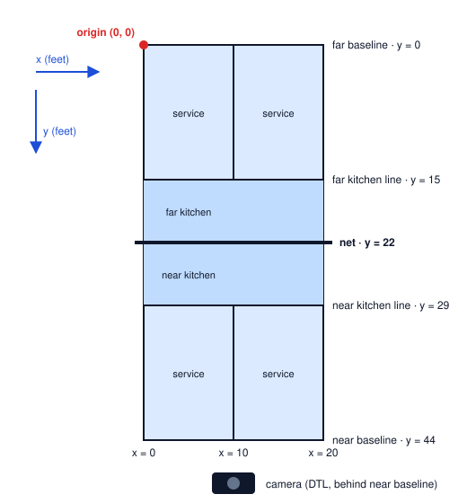

# Court geometry and calibration

How the pipeline describes the court, maps video onto it, and what that mapping can be
trusted for. Code in `src/dinkdata/court/` follows this file. `docs/DESIGN.md` section 6.3 has
the reasoning, and ADR 0004 records the decision.

## Court dimensions

USA Pickleball rules, in feet.

| Item | Value |
|---|---|
| Court width | 20 ft |
| Court length | 44 ft |
| Net to kitchen line | 7 ft on each side |
| Net height | 36 in at the sidelines, 34 in at the centre |
| Line width | 2 in |

A ball touching a line is in, except a serve touching the kitchen line, which is a fault.

## Coordinates

- The origin is the far-left baseline corner as seen from the camera. For a diagonal
  camera, "far" means the baseline farther from the camera.
- x runs from 0 to 20 across the court. y runs from 0 to 44 toward the camera.
- The net is at y = 22. The kitchen lines are at y = 15 and y = 29.
- Positions are stored in feet. A position the camera can't see is `null`.

## Keypoints

Calibration matches clicked image points to these named points. Code names them and never
numbers them.

| Name | x | y |
|---|---|---|
| far_left_corner | 0 | 0 |
| far_right_corner | 20 | 0 |
| near_right_corner | 20 | 44 |
| near_left_corner | 0 | 44 |
| far_kitchen_left | 0 | 15 |
| far_kitchen_right | 20 | 15 |
| near_kitchen_right | 20 | 29 |
| near_kitchen_left | 0 | 29 |
| far_kitchen_centre | 10 | 15 |
| near_kitchen_centre | 10 | 29 |
| far_baseline_centre | 10 | 0 |
| near_baseline_centre | 10 | 44 |
| net_top_left | 0 | 22, height 3 ft |
| net_top_centre | 10 | 22, height 2.83 ft |
| net_top_right | 20 | 22, height 3 ft |

The net tops are where the top of the net crosses above each sideline and the centre line.

Calibration also uses these named court lines. Code names them and never numbers them.

| Name | From | To |
|---|---|---|
| far_baseline | (0, 0) | (20, 0) |
| near_baseline | (0, 44) | (20, 44) |
| left_sideline | (0, 0) | (0, 44) |
| right_sideline | (20, 0) | (20, 44) |
| far_kitchen_line | (0, 15) | (20, 15) |
| near_kitchen_line | (0, 29) | (20, 29) |
| far_centre_line | (10, 0) | (10, 15) |
| near_centre_line | (10, 29) | (10, 44) |

The net's own floor line at y = 22 is left out, because the net hides it.

The coordinates above are the court's boundaries. Painted lines are 2 in wide and lie inside
the area they bound: the sidelines and baselines inside the 20 by 44 ft court, and each
kitchen line inside its kitchen, so its centre is 6 ft 11 in from the net. A person clicks a
line's centre, so the solver places the baselines, sidelines and kitchen lines, and the
keypoints on them, at the line's centre, 1 in in from these coordinates. Near a low camera 1 in
is about 3 px. The centre line divides the two service courts, so its centre stays at x = 10.
Only its ends move, with the baseline and the kitchen line, so the `*_centre` keypoints move
along y and never along x.

## Calibration

1. A person runs `dink calibrate <camera_id>` and clicks the visible keypoints, 3 to 5
   points along each visible court line, and the net tops (`docs/LABELLING.md`). The tool
   needs at least 4 named floor keypoints, no 3 of them on one court line.
2. The solver fits a pinhole camera with one focal length, the principal point at the image
   centre and radial distortion (k1, k2), using `scipy.optimize.least_squares` with a robust
   loss. Net heights are soft constraints, because rec nets can sag. Its constants scale
   with the image size, so no pixel threshold is hardcoded.
3. Each camera is fitted alone first, with weak priors on the lens. A joint fit can share
   the lens across a lens group, with a small correction per camera. #50 decides the groups
   (ADR 0020).
4. The held-back error is the mean leave-one-out error over the named floor keypoints.
   `camera.json` v1 stores it in `reprojection_error_px`. It must stay under a threshold, set
   from the first 20 calibrations. That threshold is in pixels at full 1080p resolution, the
   only size PickleCam records today, so another size would need it scaled.
5. The solver refuses a fit that puts the camera below the floor or on the far side of the
   net, which usually means swapped names, a lens whose undistortion folds inside the
   farthest click from the image centre, or a fit that didn't converge. The clicks don't fix
   the lens beyond the farthest one, so a fold between it and the image corner is allowed.
   The floor functions give NaN past the fold, and the visibility mask stops short of it.
6. The visibility mask is the image border projected onto the floor, clipped at the horizon
   and at 10 ft beyond the lines on every side.
7. The tool suggests the camera setup from the fit. A camera turned more than 20° off the
   centre line is diagonal, however high it is. Otherwise one more than 2 m (6.56 ft) above the
   floor is down-the-line high.
   The person confirms it, and saving sets it on the camera's catalog rows.
8. The result is saved as `cameras/{camera_id}/v{n}/camera.json`, with the raw clicks in
   `clicks.json` beside it. A new calibration is a new version, and old versions are never
   overwritten.
9. From M1, every video's background is compared with the projected court lines. A
   mismatch flags the camera as moved.

`image_to_court` takes raw video pixels, with the lens distortion still in them, and gives
NaN for a pixel at or above the horizon. `court_to_image` takes floor points, or points with a
height such as the net tops. Both need only numpy.

## What the mapping can be trusted for

| Use | Allowed | Reason |
|---|---|---|
| Player foot position | Yes | The foot is on the floor |
| Ball bounce position | Yes | The ball touches the floor |
| Ball in flight | No | The ball is above the floor, so the projection lands in the wrong place |
| Ball height or speed | No | Needs a 3D estimate, which v1 doesn't have |

## Zones

| Zone | Rule |
|---|---|
| In court | 0 ≤ x ≤ 20 and 0 ≤ y ≤ 44 |
| Far kitchen | 15 ≤ y ≤ 22 |
| Near kitchen | 22 ≤ y ≤ 29 |
| Service court | The box diagonal from the server, between the kitchen line and the baseline, split at x = 10 |
| Close call | A bounce within the line width plus the calibration error of a line. Flagged for review |
