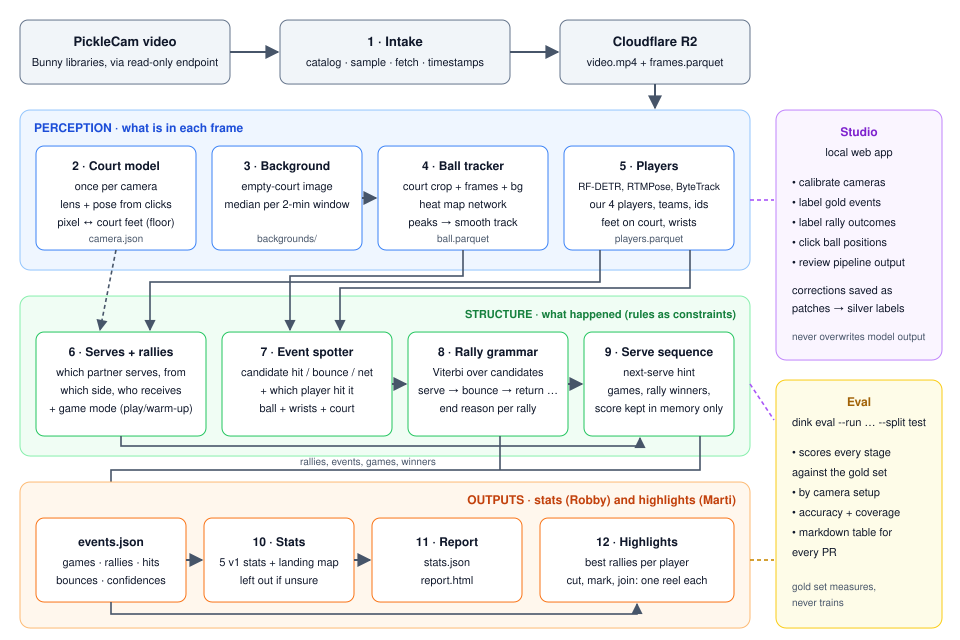
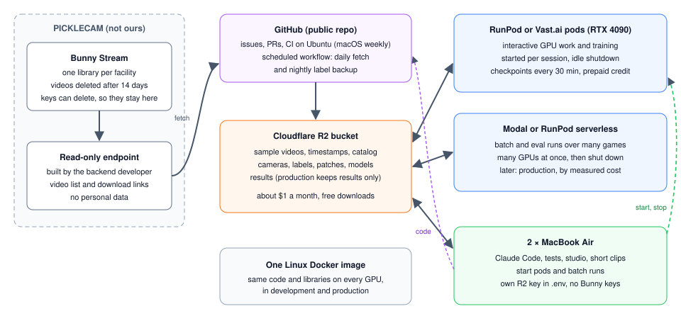
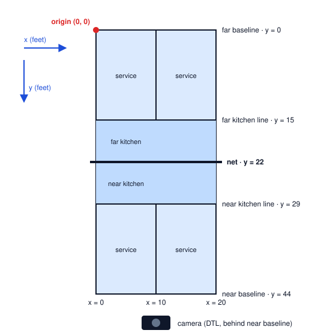
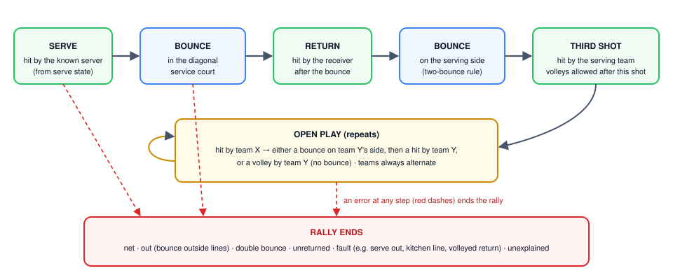
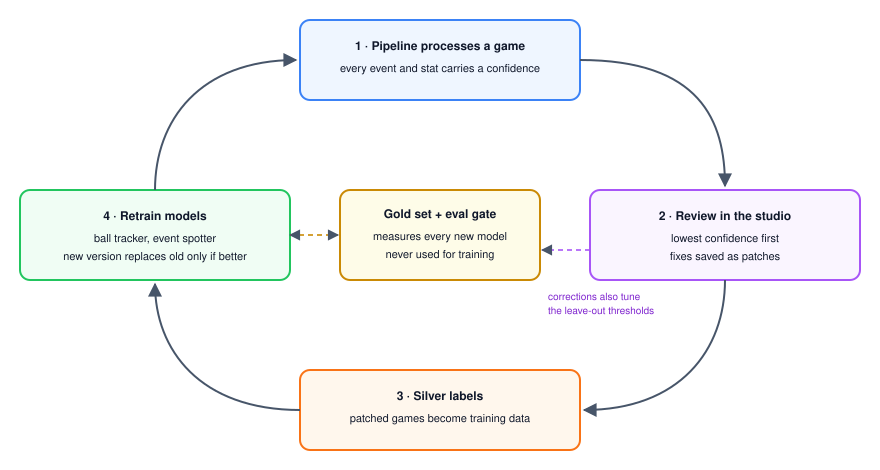

# DinkData design document

The product requirements, technical design and system design for DinkData. This file is the single source of truth.

| | |
|---|---|
| Version | 1.10 |
| Date | 21 October 2026 |
| Owners | Robby (`@roberto-cantero`) and Marti (`@probablynotmarti`) |
| Prepared with | Claude Code, after a review session with Robby and review comments from Marti |
| Replaces | `docs/DinkDataRebuildPlan.pdf` and every doc based on the `legacy/` prototype |
| Status | Final draft, reviewed by both owners in its PR. Nothing is built yet |

Section 1 is the summary. Sections 2 and 3 explain why and what. Sections 4 to 7 explain how
the system works. Sections 8 to 13 cover data, labelling, evaluation, compute, the repo and
licensing. Section 14 is the roadmap and the setup phase, and section 15 lists risks. The
glossary in section 4 defines every technical term.

## Contents

1. [Summary](#1-summary)
2. [Findings](#2-findings)
3. [Product requirements](#3-product-requirements)
4. [Glossary](#4-glossary)
5. [System architecture](#5-system-architecture)
6. [The pipeline, stage by stage](#6-the-pipeline-stage-by-stage)
7. [Data contracts](#7-data-contracts)
8. [Data, storage and privacy](#8-data-storage-and-privacy)
9. [Labelling and the gold set](#9-labelling-and-the-gold-set)
10. [Evaluation and targets](#10-evaluation-and-targets)
11. [Compute and costs](#11-compute-and-costs)
12. [Repository and development workflow](#12-repository-and-development-workflow)
13. [Licensing](#13-licensing)
14. [Roadmap, setup phase and first issues](#14-roadmap-setup-phase-and-first-issues)
15. [Risks and open questions](#15-risks-and-open-questions)
16. [Sources](#16-sources)

Appendices: [A. Decision log](#appendix-a-decision-log) · [B. Questions for the PickleCam backend developer](#appendix-b-questions-for-the-picklecam-backend-developer)

## 1. Summary

DinkData takes a PickleCam recording of a doubles pickleball game and produces two things
for every player in it: **stats** and a **highlight reel**. PickleCam cameras sit above
courts at about 140 facilities and record thousands of games a week. For now DinkData runs
on its own: a video goes in, stats and reels come out. Sending them with PickleCam's video
emails comes later, once the accuracy targets are met.

DinkData is a standalone app first. The first goal is a prototype whose stats and reels are
accurate and reliable enough for PickleCam to pay for, because players ignore or complain
about wrong stats. We show it to PickleCam's CEO at the end of M3. The prototype is built on
about 150 games downloaded by hand from the facility dashboard. `dink run` takes one of them
and writes the report and each player's reel MP4 to a folder. Integration with PickleCam,
automatic intake, delivery to players and production cost come in M4, after PickleCam
approves the prototype, built around whatever PickleCam already runs (ADR 0018).

The v1 has two priorities, and each owner leads one.

- **Stats, led by Robby.** Serve in % and depth, return in % and depth, net and out errors
  per player, and winners per player. A landing map of serves, returns and out-errors comes
  almost free. DinkData doesn't report the score (ADR 0019).
- **Highlights, led by Marti.** A short video for each player, stitched automatically from
  their best rallies in the game.

The pipeline has three layers. Perception finds the court, the ball and the four players in
every frame. Structure turns those detections into a game log of rallies, hits, bounces, who
hit each ball and who won each rally. Outputs read the game log and produce stats, a report and the
highlight reels.

Five ideas carry the design.

1. **The rules of pickleball are the strongest model.** A rally grammar decoder picks the most
   likely sequence of events inside a rally that obeys the rules. It corrects many missed and
   extra detections without training labels.
2. **Nothing depends on the players keeping score.** Many PickleCam players are beginners or
   play for fun, and they lose track of side-out scoring. Players know their own score and
   would spot any score that differs from theirs, so DinkData never reports it (ADR 0019).
   Comparing one serve with the next still hints at who won the rally in between, but only as
   weak evidence next to the ball. Telling the two partners apart matters for every per-player
   serve stat, so M0 measures it first.
3. **The cameras are fixed, so each one is calibrated once.** The calibration fits a real
   lens model, including wide-angle distortion, from court points, lines and the net. Each
   video also gets background images of the empty court, which gave ball trackers their
   biggest accuracy gain in an independent benchmark.
4. **Rules first, models second.** Every stage starts as a simple rule-based version, so the
   pipeline runs end to end early. People correct its suggestions in our labelling tool, and
   the corrections train the real models.
5. **Measure everything.** One command scores every stage against a hand-labelled answer key
   called the gold set. Every pull request shows its numbers, so AI agents can build safely.

The accuracy target is each player's count for each stat off by at most one in at least 90%
of player-games. We measure accuracy
over the stats we ship and always report coverage, the share of stats shipped. A stat with
low confidence is left out, not shown wrong. During the beta, a person reviews every game.

After the prototype, cost per video matters, because PickleCam receives about 4,500 videos a
day. Built the straightforward way, production would cost about $13,000 a month. The plan targets
under $0.01 a video, about $900 to $2,000 a month at today's volume, through cheaper GPUs,
processing only the play segments, a cheaper bandwidth tier, and storing results instead of
videos (section 11).

| Milestone | Ends with |
|---|---|
| Setup, done by this session | Docs, an empty package layout, CI and GitHub issues ready for other sessions |
| M0 Foundations | Data contracts, 150 hand-downloaded games in storage, stats tested on hand-written logs, a highlight renderer working from a hand-written rally list, partner identity measured, and labelling under way |
| M1 Ground truth | Calibrated cameras, the labelling tool, the gold set, the eval command, and a first end-to-end version producing a report and a reel |
| M2 Serve states and first reels | Serve states and rally winners meet their targets, rally-based reels per player, ball tracker v1 |
| M3 Ball stats and full reels | Stats 2 to 5, the landing map and per-player reels built from winners and aces |
| M4 Integration and beta, after PickleCam approves the prototype | Automatic intake through PickleCam's endpoint, batch processing, reels played over PickleCam's video, automatic calibration, delivery to beta players with human review, and a measured production cost per video |

M0 to M3 build the prototype. M3 ends with every v1 stat and reel meeting its gate on
held-out facilities, and that is the version we show PickleCam's CEO. After M2 we decide
whether an internal preview of the first reels is worth showing early.

## 2. Findings

### 2.1 The footage

These findings come from the PickleCam dashboard (five facilities and seven cameras,
including one diagonal camera) and from the video host's API documentation, on 17 October 2026.

| Finding | Consequence |
|---|---|
| About 140 facilities with 3 to 10 cameras each. One facility recorded 50 sessions in about 12 hours | Footage is plentiful. Labelling time is the bottleneck |
| A recording is usually one game of 11 to 14 minutes. Recordings stop at 45 minutes | Recordings can still contain warm-up, several games or a game cut off at 45 minutes |
| Videos are deleted 14 days after upload | We copy the games we need promptly |
| 1080p H.264 with audio at about 4.4 Mbps, roughly 0.4 GB per 12-minute game. The nominal rate is 30 fps, with occasional dropped frames, from several camera models | All timing uses frame timestamps, never `frame / 30` |
| The host is Bunny Stream, with one library per facility and titles like `court<N>_<sessionId>` | We can list and download videos through its API |
| Wide-angle lenses bend the court lines. Corners are often out of frame, and diagonal cameras miss part of the near court | A plain 4-corner homography is wrong. Calibration must work from partial courts, and some bounces are not visible |
| On low cameras the near players' feet are often below the frame | Player positions need a fallback |
| Neighbouring courts appear in frame. A PickleCam watermark with a ball icon and a facility logo sit in the corners | Detections are filtered to our court, and the overlays are masked |
| Every recording lists the players' email addresses | Our data keeps opaque ids only |
| The audio carries music, talk, shoe squeaks and 3 to 8 neighbouring courts | We don't use audio, and we drop it when copying |

| Camera setup | Approximate share | What it looks like |
|---|---|---|
| Down-the-line, low (2 m or below) | 64% | Behind one baseline with steep perspective. Near corners and feet are often cut off |
| Down-the-line, high (above 2 m) | 16% | All corners usually visible, with less occlusion |
| Diagonal | 20% | Off a corner. The net runs diagonally and much of the near court is out of frame |

The shares are the team's estimates. The seven sampled cameras are consistent with them.

### 2.2 The current repo

The repo already has good tooling: uv, ruff, pyright, pre-commit with secret scanning, CI,
CODEOWNERS and templates. It was built around a pre-AI prototype, though.

- `legacy/` is a fork of TrackNetV3, a badminton tracker. Its checkpoints and labels are
  lost. Its code assumes a CUDA GPU, loads whole videos into memory, assumes 1280×720 at 30
  fps and measures everything in pixels. We tag it and delete it, and start from scratch.
- The court, stats and failure-log docs and the old plan PDF were written from the
  prototype. This document and short topic docs replace them.
- The event schema can't express a bounce that isn't visible, a game, a timestamp or a serve.
  Contract rules run only inside tests. `torch` is a core dependency, so even stats tests
  install gigabytes. `.gitignore` hides any folder named `test/` and any `*.sh` file. CI runs
  only on Linux. `LICENSE` is MIT and names only the TrackNetV3 author.
- Marti's open PR #26 sets up Matt Pocock's agent skills. Section 12.2 builds on it.

### 2.3 Research

- We found no published computer-vision research on pickleball. Our thousands of games from
  fixed cameras are an advantage.
- For ball tracking, WASB, published at BMVC 2023, beat TrackNetV2 in its authors' tests, but its official
  code can't train. The independent RacketVision benchmark from 2025 covered about 435,000
  frames of tennis, badminton and table tennis. TrackNetV3 with a background image and 4 input
  frames was best overall, and the background image alone cut pixel error by 54 to 61%.
- Event-spotting models find tennis hits and bounces to within a frame or two. A bounce
  classifier working on 2D ball paths reached an F1 of 0.92 on tennis, and the way it proposed
  candidates mattered more than the classifier.
- A tennis system that decoded ball events with a grammar of the rules had fewer false and
  missed events than detectors alone.
- PnLCalib calibrates sports cameras from points and lines and models lens distortion. One
  flat, partial court constrains a lens poorly, so lens parameters should be shared across
  cameras of the same model, and the net adds a known height.
- Video AI models such as Gemini give timestamps to about a second, too coarse for hits.
  SAM 2 and SAM 3 struggle with small fast balls. Audio hit detection fails with
  neighbouring-court noise.
- CVAT and Label Studio are the standard free labelling tools. Racket-sports teams often build
  a small custom tool for event labelling.

## 3. Product requirements

### 3.1 Users and outputs

Players get a video of their game but no numbers and no highlights. Competitors already
analyse games from facility cameras. PB Vision takes video from PodPlay clubs, from Sporfie's
recording pipeline, and since April 2026 from Save My Play cameras through DUPR, where players
need no app or account. Our advantage is PickleCam's existing reach: cameras at about 140
venues recording thousands of games a week, with players' emails already attached. DinkData
adds stats and reels to games PickleCam records anyway, so a player gets them without doing
anything.

The v1 users are recreational doubles players at PickleCam venues, through a beta, and the two
owners, who need tools to label, review and measure. Facilities, coaches and the PickleCam
integration come later.

The input is one PickleCam recording, identified by an opaque `video_id`, with its camera id.
For each game in the recording, DinkData writes these files.

- `events.json`, the game log. It stays internal, because its rally winners and servers
  would let anyone rebuild the score.
- `stats.json`, every stat for every player, with a confidence and a shipped flag. It stays
  internal too, and the report shows its shipped stats.
- `report.html`, a one-page report headed by the game number, date and length, with a card
  per player with a photo and their numbers, and the landing map. It shows no score.
- `highlights.json`, a reel for each player as a list of clips, and one reel MP4 per player
  rendered from it. In M4 a web player can play the clips from PickleCam's video instead, and
  MP4s are rendered only on request (ADR 0012).

Every player gets the whole-game report and every reel, and finds themselves by photo. The v1
covers doubles under any scoring system, because no stat depends on the score. Rally-level
gold labels cover side-out games only for now. If rally-scoring games turn up in the
prototype's games, the labeller gains a scoring format.

### 3.2 Stats (Robby)

Every stat is a pure function of `events.json`, with unit tests built from hand-written logs.
`docs/STATS.md` will hold the full definitions and becomes the authority for the code.

| Stat | Definition |
|---|---|
| Serve in % | Serves whose first bounce lands in the diagonal service court, divided by serves. A serve touching the kitchen line is a fault. Close calls go to review |
| Serve depth | Feet from the serve's first bounce to the receiver's baseline. Deep is 5 ft or less, medium 5 to 10 ft, short over 10 ft, to be confirmed on real data |
| Return in % | Returns whose first bounce lands in the serving team's half, divided by returns |
| Return depth | Feet from the return's bounce to the serving team's baseline, with the same buckets |
| Net and out errors | The player hit the shot that ended the rally, and it didn't cross the net or first bounced outside the court. Serve faults are counted separately |
| Winners | The last shot of a rally the player's team won, which no opponent touched |
| Landing map | A top-down court showing the player's serve and return bounces and the bounce spots of their out-errors |

Serve faults come free from the same events. DinkData shows no number that players could
check against the score they remember: no final score, games won, points scored or rallies
won (ADR 0019). Later stats, in
order unless the beta says otherwise, are dink success rate (a dink that lands in the
opponents' kitchen and isn't an error), an all-shots heat map, unforced errors and forehand
versus backhand. The owners approve any other stat first.

### 3.3 Highlights (Marti)

A highlight reel is a short MP4 for one player, built from clips of rallies in that game.
PickleCam's own highlights are fixed 30-second clips that a command at the court creates, and
few recordings have one. Nothing picks highlights automatically (`docs/DATA.md`). DinkData's
reels need no action from the players.

DinkData scores every rally for each player and keeps the best ones. The v1 rules are below.

| Moment | Score | Available from |
|---|---|---|
| A long rally the player took part in, by shot count or duration | Higher for longer rallies | M2, from rally start and end |
| A rally the player's team won on that player's serve | Medium | M2, from the rally winner |
| The final rally of the game | Bonus | M2 |
| A winner hit by the player | High | M3, from hitter attribution |
| An ace: the player's serve that the receiver didn't return | High | M3 |
| A long dink exchange | Medium | Later, once dinks exist |

A reel holds the top-scoring clips in time order, about 5 to 8 clips and 30 to 90 seconds in
total. Each clip starts about 1 second before the serve and ends about 1.5 seconds after the
rally ends. The reel opens with a title card showing the player's photo crop, the game number
and the date, and no score. A small marker under the player's feet, taken from tracking, shows who the reel is
about. In the prototype the renderer cuts and joins the clips with FFmpeg into an MP4 for
every player. In M4 a web player plays the clips straight from PickleCam's video and draws the
marker from the tracking data, and the renderer runs only when a player taps download or
share. It re-encodes, because
cuts without re-encoding can only start on keyframes.

A reel is good if every clip contains the whole rally, the player appears in every clip and
the marker sits on the right person. Beta players also rate their reels. The eval command
checks clip boundaries against the rally gold labels, as section 10 describes.

### 3.4 Accuracy, coverage and review

| Requirement | Target | Measured on |
|---|---|---|
| Rally winners | The winning team matches gold on at least 95% of rallies, provisionally | Rally-level gold test set, about 30 games plus the 8 full-event test games |
| Per-player counts | For each stat, off by at most 1 in at least 90% of the player-games where it's shipped, and better than a trivial baseline | Full-event gold test set, 32 player-games |
| Depth | The bucket matches gold for at least 90% of visible serves and returns, provisionally | Full-event gold |
| Hits and bounces | F1 no more than 0.03 below human agreement, provisionally | Full-event gold |
| Highlight clips | At least 95% of clips contain the whole rally, and the marker is on the right player | Rally-level gold and beta review |
| Partner identity | The server's identity is right at a high rate, set after the M0 spike, for the near and the far team separately | Hand-labelled serves, then the rally-level gold set |
| Coverage | Reported overall and per camera setup. Provisionally each stat ships for at least 70% of player-games overall. Floors per setup are set after M1 | All gold sets |

"Off by at most 1" is easy to meet for stats that are often 0 to 3 per player-game, such as
winners and errors. A model that always answered 1 could pass. So the eval command reports a
trivial baseline next to each stat, which predicts every player's median count from the
training games, and a stat ships only if it reaches 90% and beats that baseline.

Coverage depends on the camera. On low down-the-line cameras, near-court bounces are often
out of frame, so serve-in and depth for serves into the near court can't reach 70% there.
Coverage is therefore reported for each camera setup, and each setup gets its own floor once
M1 shows what is possible. The 70% figure stays as a provisional overall target.

The test sets are small. If 27 of 30 games are right, the true rate lies somewhere between
about 74% and 97%, so every number comes with a 95% confidence interval, and the test sets
grow over time. Below a confidence threshold a stat is marked as not shipped, with a reason
such as "near-court bounces aren't visible from this camera". Beta-review corrections set the
thresholds. During the beta an owner reviews every game, which takes about 10 minutes, and
the corrections become training data.

### 3.5 Out of scope, and constraints

The v1 has no PickleCam integration, email sending, accounts or web app. It has no score, no singles,
ball speed, spin, forced versus unforced errors, forehand versus backhand or
dink stats. It doesn't use audio, and it flags close line calls but never rules on them.

| Constraint | Consequence |
|---|---|
| Two new developers who build with Claude Code | Small tested modules, clear contracts, PRs with eval numbers, docs written for agents |
| Spend as little as possible, with no contractors | Cheap cloud GPUs with a $50 monthly development budget, free tools, R2 storage at about $1 a month, we label ourselves, and production targets under $0.01 a video |
| A public repo | AGPL-3.0, and no secrets, footage, facility names, session ids or emails in it |
| MacBook Airs for development, cloud GPUs for compute | The code runs on macOS and Linux, all GPU work uses one Linux Docker image, and CI tests Ubuntu and macOS |
| Any Bunny key can delete customer videos | We download the prototype's games from the dashboard, and after the prototype read videos only through a read-only endpoint that PickleCam builds |

## 4. Glossary

### 4.1 Development

| Term | Meaning |
|---|---|
| Repo, branch, PR | The project folder tracked by git, a separate line of work, and a request to merge a branch into `main` that the other owner reviews |
| CI | Checks GitHub runs on every PR: lint, types and tests |
| Lint, type checker | ruff catches mistakes and enforces style. pyright checks that values are used consistently |
| Unit test, smoke test | A unit test checks one function. A smoke test runs a tiny example end to end to check nothing crashes |
| Spike | A short experiment to learn whether an approach works |
| Gate | A measurable condition to meet before moving on |
| CLI | A command-line tool. Ours is `dink`, as in `dink eval --split test` |
| uv, extra, wheel | uv installs Python and libraries. An extra is an optional group of libraries, such as `cv` with PyTorch. A wheel is a pre-built package |
| API, endpoint | A way for programs to talk over the web. An endpoint is one URL that answers one kind of request |
| Contract, schema, pydantic | A contract is the exact format of a file passed between stages. A schema describes it. pydantic defines formats as Python classes and validates data |
| JSON, Parquet | A text format for structured data, and a compact format for large tables |
| R2, rclone | Cloudflare's file storage, and a tool that syncs files with it |
| `.env` | A local file of secrets that is never committed |
| HMAC | A one-way code made from text and a secret key. Nobody without the key can recompute or reverse it |
| ADR | A short record of one decision and its reasons, kept in `docs/adr/` |
| Docker image, pod | A packaged copy of our code and its libraries that runs the same on any machine, and a rented remote Linux machine with a GPU |
| Serverless GPU | A cloud GPU billed per second only while a job runs, then shut down |
| Spot instance | A cheap cloud machine the provider can take back at short notice. Fine for jobs that can retry |
| Pull zone, volume network | A Bunny configuration that serves files, and Bunny's cheaper delivery network with fewer locations |
| Agent, skill | Claude Code working from a written issue. A skill is a packaged workflow it follows, such as `/implement` |
| Licenses | MIT, BSD and Apache allow any use if you keep the notice. LGPL allows use as a library. AGPL-3.0 requires anyone who distributes the code, or runs a changed version as a network service, to offer its source to users. A CLA lets owners relicense contributions |

### 4.2 Video and computer vision

| Term | Meaning |
|---|---|
| Frame, fps, timestamp | One image, frames per second, and the exact time a frame is shown. With dropped frames, frame 900 isn't at 30.0 seconds |
| Codec, keyframe, decode | H.264 compresses video. A keyframe is stored whole, and the frames after it store changes. Decoding turns video back into images |
| HLS, remux, FFmpeg, ffprobe | A streaming format made of small chunks, repackaging video without re-compressing it, and the standard video tools. ffprobe reads timestamps |
| NVDEC, NVENC, TensorRT | NVIDIA's video decoder and encoder chips on the GPU, and NVIDIA's tool that makes models run faster |
| Detection, bounding box | Finding an object, usually as a rectangle with a confidence |
| Tracking, tracklet | Linking detections of the same object across frames. A tracklet is a short unbroken piece of a track |
| ByteTrack, ReID | A standard tracking algorithm based on motion, and re-identification of a person by appearance |
| Pose, keypoints | Body joints such as wrists, hips and ankles, found as points |
| RF-DETR, RTMPose, COCO | A person detector and a keypoint model, both Apache-2.0, and the public dataset most detectors learn from |
| Heat map | A grid of scores for how likely the ball is at each pixel. The peak is the prediction |
| Background image | The empty court, made from the median of many frames, so moving things vanish |
| Calibration, intrinsics, extrinsics | Working out the lens (focal length, centre, distortion) and the camera's position and angle, so pixels convert to court feet |
| Pinhole model, lens distortion | The standard maths of how a camera projects points, and the way wide lenses bend straight lines |
| Homography | A mapping between the floor and the image. It is only valid for points on the floor, such as feet and bounces |
| Reprojection error | The distance in pixels between known court points and where the calibration puts them |
| Occlusion, visibility mask | One thing hiding another, and the parts of the court a camera can see |

### 4.3 Machine learning

| Term | Meaning |
|---|---|
| Model, training, inference | Behaviour learned from examples, the learning, and running the model on new data |
| Label, checkpoint | A correct answer written by a person, and a saved trained model |
| Pretrained, fine-tuning | Already trained on general data, and trained further on ours |
| Train, dev and test splits | Data to learn from, data to tune choices on, and data used only to report results |
| Held-out facility, overfitting | A facility used only for testing, and a model that memorises its training data |
| Gold, silver labels | The hand-made answer key, which never trains, and model output corrected by a person, which does |
| Self-training | A model labels new data and retrains on its confident labels |
| Confidence | The model's certainty from 0 to 1. It decides review order and which stats ship |
| Precision, recall, F1 | Of what we found, the share that was right. Of what was there, the share we found. F1 combines both |
| Tolerance | How close in time a detection must be to count, such as 2 frames |
| Event spotting | Finding the exact frame of a hit or bounce |
| HMM, Viterbi | A model of hidden states, such as which candidates are real events, seen through noisy evidence, and the algorithm that finds the most likely sequence of states |
| Encoder-decoder, U-Net | A network that shrinks an image to understand it, then grows it back to locate things |
| Loss, weighted cross-entropy | The number training reduces, and a version that weights rare things like the ball more |
| Augmentation | Extra training examples made by changing brightness, adding blur or flipping images |
| Gradient-boosted trees | A classic method for tables of numbers that works with little data |
| Robust loss | A fitting method that limits how much one bad click can move the result |
| MAE, confidence interval | The average size of the errors, and the range likely to hold the true value |
| GPU, CUDA, MPS | A graphics card for fast ML, NVIDIA's software for it, and Apple's equivalent |

### 4.4 Pickleball and project terms

| Term | Meaning |
|---|---|
| Rally, side-out | Play from the serve until the ball is dead, and the moment the serving team loses the serve |
| Side-out scoring | Only the serving team scores. Each team gets two servers per turn, except the first turn of a game, which starts at `0-0-2`. Games go to 11, win by 2. Players often get it wrong, so DinkData doesn't report the score |
| Rally scoring | Either team can score on any rally. Supported, because no stat reads the score |
| Starting positions | A team's players stand on their starting sides whenever that team's score is even, and switch only after winning a point on their own serve. Each service turn starts from the right. DinkData uses this only as an internal tiebreak |
| Two-bounce rule | The serve and the return must bounce before being hit. Volleys are allowed after that |
| Kitchen, service court | The 7-ft no-volley zone by the net, and the diagonal box a serve must land in |
| Fault | A rule break that ends the rally, such as a serve out, a volleyed return, a kitchen volley, the ball hitting a player or a foot fault |
| Volley, dink, lob, stacking | A shot before the bounce, a soft shot into the kitchen, a high shot, and partners lining up on non-standard sides |
| Net-cord serve, close call | A serve that clips the net and lands in is live. A close call is a bounce near a line that we flag for review |
| Catalog | Our list of known videos, with no personal data |
| Serve state | Who serves, which partner, from which side, and who receives |
| Game mode | Whether the players are in a game, warming up, drilling or idle |
| Rally grammar | The rules of what can follow what inside a rally |
| Studio | Our web app for labelling, calibration and review |
| Patch | A human correction stored on top of model output |
| Coverage | The share of stats we ship |
| Eval | Our command that scores pipeline output against the gold set |

## 5. System architecture



*Figure 1. From video to stats and reels. Blue is perception, green is structure and orange is
outputs. The box numbers match the table below.*

Each stage reads and writes files in fixed formats called contracts, defined in section 7. A stage can
therefore be built and tested alone, using the saved outputs of earlier stages.

| # | Stage | Output | Owner |
|---|---|---|---|
| 1 | Intake: catalog, sample, fetch | Catalog, videos without audio, frame timestamps | Robby |
| 2 | Court model, once per camera | `camera.json`: lens, pose, court mapping, visibility mask | Robby |
| 3 | Background | Empty-court images, one per 2-minute window | Robby |
| 4 | Ball tracker | `ball.parquet`: ball position, visibility and confidence per frame | Robby |
| 5 | Players | `players.parquet`: 4 players with boxes, keypoints and feet on the court, plus photo crops | Marti |
| 6 | Serve states, game mode, rallies | The `serve` block and boundaries of each rally, play and warm-up segments | Marti |
| 7 | Event spotter | Candidate hits, bounces and net events with probabilities | Robby |
| 8 | Rally grammar decoder | Clean rallies with events and end reasons | Robby |
| 9 | Serve sequence | Games and each rally's winner. Any score stays in memory | Marti |
| 10 | Stats | `stats.json` | Robby |
| 11 | Report | `report.html` | Robby |
| 12 | Highlights | `highlights.json` with a clip list per player, and a reel MP4 per player | Marti |
| | Studio and eval | Labels, calibrations, patches, metrics | Both |

This split gives each owner the stages behind their priority. Robby owns the ball and events
path that the stats need. Marti owns players, rallies and the serve sequence, which the
highlights need first. It replaces the earlier split, in which Marti owned stats.



*Figure 2. Videos flow from PickleCam through a read-only endpoint into our R2 bucket. Until
the prototype is approved, we download them from the dashboard by hand instead (ADR 0018).
Rented cloud GPUs do all the GPU work, in development and production. Section 11 covers the
costs.*

The architecture follows these rules.
- Every file passed between stages has a contract, and a stage that writes an invalid file
  fails.
- Time always comes from timestamps.
- The court mapping applies only to points on the floor.
- Every detection carries a confidence.
- A rule-based version of each stage comes before its model.
- Every change to a model, threshold or rule shows eval numbers before and after.
- Human corrections are stored as patches and never overwrite model output.
- No personal data appears in code, labels, logs or PRs.

## 6. The pipeline, stage by stage

### 6.1 Intake (`dinkdata.data`, Robby)

For the prototype, intake starts from games downloaded by hand (ADR 0018). The owners pick
about 150 games from about 40 facilities. They hold out whole facilities for testing, at least
one per camera setup and more for low down-the-line cameras. They spread the rest across
cameras, court colours and game lengths, and skip recordings under 5 minutes. The split never
changes once labels exist. Robby downloads each game's 1080p MP4 from its watch page within 14
days of upload.

`dink ingest` takes one downloaded MP4. It drops the audio track with `-map 0:v`, saves every
frame's timestamp with ffprobe, and flags dropped and duplicated frames. It asks for the
session id, facility and court at a hidden prompt, gives the game its HMAC `video_id` and
`camera_id` (ADR 0016), adds a catalog row and uploads the results to R2, skipping files
already there. `dink run <video_id>` finds the game's camera, and so its calibration, in that
row. Running on a loose MP4 and recognising its camera automatically wait for M4. Bunny's MP4 keeps dropped-frame gaps, and the duplicate check stays in case a
camera or encoder fills them.

After the prototype, intake runs on its own. `dink catalog sync` reads PickleCam's read-only
endpoint, specified in section 8.2, and writes one row per video. Each row has an opaque `video_id`, which is an HMAC of the session id keyed with a
secret in `.env`, plus hashed facility and camera ids, the upload time, length, frame rate,
size, the camera setup once calibrated, and the split. The map from our ids back to session
ids lives only in a private `catalog/id_map.parquet` in R2.

`dink sample` applies the same selection rules to the catalog.

`dink fetch` downloads each new game's 1080p MP4. Without one, it takes the original upload,
and otherwise the HLS stream, which it remuxes with `ffmpeg -c copy` without quality loss (ADR 0017), and passes
the file to the same steps as `dink ingest`. A scheduled GitHub Actions workflow runs fetch
daily, so selected games are copied before PickleCam deletes them.

In production, fetch doesn't copy videos into R2. Catalog sync puts each new video on a job
queue, and a GPU worker reads the video from Bunny, processes it and stores only the results
(section 11.5).

### 6.2 Video I/O (`dinkdata.video`, Robby)

PyAV, which includes FFmpeg on every OS, reads frames with their timestamps, both in sequence
and by exact random access. Every duration and speed uses timestamps. A pre-commit check and
code review catch `frame / 30`, because dropped frames make it drift by seconds over a long
game.

### 6.3 Court model and calibration (`dinkdata.court`, Robby)



*Figure 3. Court coordinates in feet. The origin is the far-left baseline corner as seen from
the camera. x runs 0 to 20 across the court and y runs 0 to 44 toward the camera. The net is
at y = 22 and the kitchen lines are at y = 15 and y = 29.*

1. A person clicks the visible named court points, several points along each visible line,
   and the top of the net, which is 36 in high at the sidelines and 34 in at the centre. A
   command-line click tool comes first and a studio mode later.
2. A solver fits a pinhole camera with radial lens distortion, using
   `scipy.optimize.least_squares` with a robust loss. It moves points to their places, line
   points onto their lines and the net tops to their heights. Rec nets can sag, so the net
   heights are soft constraints.
3. One partial court can't pin down a lens, so the solver fits lens parameters jointly across
   cameras of the same model. Each camera then gets its own pose and a small distortion
   correction.
4. The reprojection error on held-back clicks decides whether a calibration passes. The first
   20 calibrations set the threshold.
5. The visibility mask is the image border projected onto the floor, clipped at the horizon.
   A bounce outside it is not visible, rather than out.
6. `image_to_court` and `court_to_image` convert between pixels and feet, with tests on
   synthetic cameras.

The prototype needs this one-time calibration for each camera before `dink run` works on its
games, including the held-out facilities' cameras, since calibrating isn't training.

From M1, each video's background is compared with the projected court lines. A mismatch flags
a camera that moved. A calibration takes about 2 minutes, so our sample of about 100 cameras
takes a few hours. All of PickleCam could reach 1,400 cameras, about 47 hours of clicking, so
M4 trains an automatic calibration model on our own calibrations.

### 6.4 Background (`dinkdata.ball`, Robby)

The background step samples one frame per second and takes the pixel median of each
2-minute window. It stores the images in `runs/{run_id}/{video_id}/backgrounds/`. Separate
windows handle changes in lighting and camera exposure.

### 6.5 Ball tracker (`dinkdata.ball`, Robby)

1. The tracker crops the frame to the court, with room above for lobs and margin outside the
   lines for out balls. The far ball keeps more pixels than if the whole frame were shrunk. It
   masks the overlays.
2. The input is 3 to 8 consecutive crops plus the background crop, at 288×512 to start.
3. A TrackNet-style encoder-decoder outputs a heat map per frame. It trains with weighted
   cross-entropy on small Gaussian targets. We write it from scratch, so the architecture can
   change later.
4. Heat map peaks link into smooth tracklets. Tracklets that never cross our net, or bounce
   outside our court, belong to neighbouring courts and are dropped. Gaps of up to 10 frames
   are filled with a fitted curve and marked `interpolated`.
5. Training starts with about 4,000 hand-clicked frames in 2-second clips from about 30
   training games. After that, people accept or fix the model's uncertain frames. About 1,000
   separate test frames measure it. Augmentation changes brightness, adds blur, shifts crops
   and flips left to right.

This is the best recipe in the 2025 benchmark, and fixed cameras suit it. The WASB comparison
and self-training wait until v1 stops improving. On low cameras the far ball is tiny, which
the crop, larger inputs and more labels address. At a hit the ball is often hidden, so the
event spotter also uses wrist keypoints and heat map peaks.

### 6.6 Players, serve states, game mode and rallies (`dinkdata.players`, Marti)

1. RF-DETR finds people in the court crop, and RTMPose finds their body keypoints. Both are
   pretrained, so they need no labelling, and both are Apache-2.0. Each sits behind a small
   interface.
2. ByteTrack, through the MIT-licensed `supervision` library, links detections into tracks.
   ByteTrack uses motion only, so an appearance model, such as OSNet from torchreid (MIT),
   re-links people after occlusion and tells partners apart.
3. A player's foot point is the midpoint of the ankles, or the bottom of the box. If the box
   touches the bottom of the frame, the foot point comes from the hips and gets a lower
   confidence. The floor mapping then places it on the court.
4. The four tracks that spend the most play time on our court, with generous margins behind
   the baselines, become the players. Fragments of one person merge by side and appearance.
5. Ids follow one convention in the pipeline and in gold labels. p1 is the first server in
   the recording and p2 is p1's partner. p3 receives the first serve and p4 is p3's partner.
   Team A is p1 and p2, and team B is p3 and p4. Appearance carries ids across games and end
   switches. Keeping partners apart matters most, so each serve checks the server against both
   stored profiles.
6. **Partner identity is the riskiest assumption in the plan.** Per-player serve stats and the
   next-serve winner hint depend on telling p1 from p2 at every serve. Partners often dress alike, the far team is small on low
   down-the-line cameras (64% of videos), and the near team is seen from behind. The player
   spike in M0 therefore measures partner-identity accuracy at the serve, separately for the
   near and far team, on serves the owners label by hand. The eval command keeps reporting it.
   M2's design is locked only after the spike shows the accuracy we can reach. If the far
   team falls short, per-player serve stats ship only for the camera setups that pass, and
   rally winners lean on the ball from M3.
7. At each serve formation the serve state records which team serves, which player, from
   which side and who receives. Internally it also notes whether each team stands on its
   starting sides, which hints at score parity. Players who lose track of the score and teams
   that stack both make that hint wrong, so it only breaks a tie when the appearance check
   can't tell partners apart, and it never goes into a file.
8. Rules based on serve formations and their rhythm label segments as `game`, `warmup`,
   `drill` or `idle`.
9. A rally starts at a detected serve and ends when the ball is dead: the ball leaves play,
   players relax and the next serve formation appears. In M2 rallies simply run from serve to
   serve.

The main risks are occlusion near the net, spectators near the court, end switches and
partners swapping ids. The appearance check catches swaps, with the parity hint as a tiebreak.

### 6.7 Event spotter (`dinkdata.events`, Robby)

1. The spotter proposes candidates and aims to miss fewer than 1% of real events. A candidate
   is a sharp change of direction, a V-shaped dip in image height, which is typical of a
   bounce, a jump in speed, the start or end of a track, or a wrist close to the ball.
2. For each candidate it computes features over 10 frames on each side. These are ball
   motion, court position where a floor contact is plausible, each player's wrist distance and
   wrist speed, the side of the net, and heat map strength.
3. Version 0 uses rules, so a change of direction near a swinging wrist is a hit. Version 1
   uses gradient-boosted trees, and version 2, if needed, a small temporal network. The
   output is the probability of a hit, bounce, net event or nothing, and for hits the
   probability of each player.
4. Only silver labels train it. In M3, people correct the rule-based version's suggestions on
   about 10 training games, and beta corrections add more later. Gold games never train.

### 6.8 Rally grammar decoder (`dinkdata.events`, Robby)



*Figure 4. The rally grammar, simplified. The dashed exits end the rally.*

The serve, by the known server, must bounce in the diagonal service court. The receiver
returns it after the bounce, and the return must bounce on the serving side. After that, hits
alternate between teams, each followed by a bounce on the other side or a volley by the other
team. A rally ends as `net`, `out`, `double_bounce`, `unreturned`, `fault` or `unexplained`.

Viterbi goes through the candidates in time order and accepts each as an event, with its
hitter, or rejects it. The classifier's probabilities and the grammar's transitions score each
choice. When the rules require an event the spotter missed, the decoder can insert a
low-confidence hit. Some legal but unusual sequences are allowed with a penalty, so the decoder
never forces nonsense. These are the ball hitting a player, volleyed serves or returns,
kitchen volleys, replays, players stopping on a wrong call and net-cord serves.

The output is a clean event list, the end reason and the winner implied by the ball. When the
ball-based winner's confidence passes its threshold, it decides the rally. Otherwise the
next-serve hint decides. A disagreement lowers the rally's `conf`, so a stat can leave the
rally out instead of guessing. Out calls follow what the players did.

### 6.9 Serve sequence (`dinkdata.serves`, Marti)

The serve sequence turns serve states into each rally's winner and the game boundaries.
DinkData never reports the score (ADR 0019), and no stage depends on it, because PickleCam
players often lose track of side-out scoring.

1. **The next-serve hint.** Each serve is compared with the next one only. If the other team
   serves next, the serving team lost. If the same player serves again from the other side,
   the serving team won. If the partner serves, the rules say the team lost with server 1,
   but a team that won and forgot to swap looks the same. So the serves can't tell, the ball
   decides from M3, and until then the rally gets a low confidence. A scoring mistake by the players
   changes at most one rally and doesn't carry through the game.
2. **The internal side-out replay.** The rules of side-out scoring, run over the whole game,
   add weak evidence where the next-serve hint can't tell. The replay lives in memory only.
   It allows rule breaks with a small penalty, drops out when the serves don't fit the rules,
   and writes nothing to `events.json`. Its rules are below.

| Previous rally | Next serve under the rules |
|---|---|
| Serving team won | The same server serves from the other side, because the partners swapped |
| Serving team lost with server 1 | The partner serves as server 2, from where they stand |
| Serving team lost with server 2, or the first server at `0-0-2` | Side-out. The other team serves from the right |
| Replay | Same server, same side, same score |

3. **Games.** A game boundary comes from a break in play: the players stop, walk, swap ends or
   reset their formation for a first serve from the right. The replay's guess at a game end
   is only a hint. A game has an id, a start, an end and its rallies, and no target, winner or
   final score.
4. If fewer than four players are on court, the recording is singles, which v1 doesn't
   support. Any scoring system works, because no stat reads the score. Gold labels are
   side-out only for now, so eval can't yet measure rally-scoring games.

### 6.10 When players break the rules

Recreational players make mistakes. They forget who served last, the wrong partner serves, a
team serves again after it should have lost the serve, a player serves from the wrong side, or
they lose track of the score and end the game at the wrong number. Most PickleCam games have
a few of these. DinkData treats this as normal, in three ways.

1. **No output depends on the score.** The players know their own score, so a score that
   differs from theirs would look wrong at once, even when our count matches what was played.
   No report, stat or reel shows the score, games won, points scored, rallies won or rule
   deviations.
2. **Rally winners come from local evidence.** The next-serve hint looks only at the next
   serve, and the ball decides when it is confident, so one mistake by the players changes at
   most one rally.
3. **Gold labels record what was played.** The rally labeller replays the score and flags
   rallies where the serves break the rules, and the labeller marks each rule deviation in
   `rallies.json`. The labeller marks every rally's winner by hand, so the replay checks the
   winner instead of choosing it. The rally-level gold set therefore shows how often players
   get the score wrong, and that number never reaches a player.

### 6.11 Stats and report (`dinkdata.stats`, `dinkdata.report`, Robby)

Each stat is a pure function that returns a value, numerator, denominator, confidence, shipped
flag and reason. Unit tests cover every rule. A serve on the kitchen line is a fault, a winner
requires that no opponent touched the ball, and a serve into an area the camera can't see is
left out. The report is one static HTML file built from a Jinja2 template, laid out for
phones, with an inline SVG landing map. It shows no score and no rule deviations.

```json
{"video_id": "v_9c1e…", "game_id": "g1",
 "players": {"p1": {
   "serve_in_pct": {"value": 0.875, "num": 7, "den": 8, "conf": 0.93, "shipped": true},
   "winners": {"value": 1, "conf": 0.64, "shipped": false, "reason": "low_attribution_conf"}}}}
```

### 6.12 Highlights (`dinkdata.highlights`, Marti)

1. The selector scores every rally for each player with the rules in section 3.3 and keeps
   the top clips within the length limit.
2. Clip edges come from rally boundaries with padding. They never cut into the next serve.
3. It writes `highlights.json` with each clip's start, end, reason and score, so a person can
   check or change the selection in review.
4. The renderer writes a reel MP4 for every player: FFmpeg cuts the clips, burns in the
   marker and title card, and joins them.
5. In M4, a web player plays each reel from PickleCam's video with the title card and marker
   drawn on top, and a serverless job renders the MP4 only on request, encoding with NVIDIA's
   NVENC, and keeps it for 30 days (ADR 0012).

In M0 the player and renderer work from a hand-written list of rallies, so they need no models. In M2 it
uses detected rallies and their winners. In M3 it adds winners and aces.

### 6.13 Studio (`dinkdata.studio`, both)

The studio is a local web app for every human task. A FastAPI server decodes frames by exact
timestamp, because browsers can't land on an exact frame, reads and writes R2, and validates
every save against the contracts. A small TypeScript page shows the frame, overlays and a
timeline.

| Mode | Milestone | Keys |
|---|---|---|
| Events | M1 | Left and right arrows move one frame, with Shift for 10. R marks rally start or end. H then 1 to 4 marks a hit and its hitter. B then a click marks a bounce. X marks a bounce out of view. N marks the net. W then A or B marks the winner. Enter accepts a suggestion, Delete rejects it and J jumps to the next uncertain item |
| Rally level | M0, as a minimal tool | A single local web page with a video player. Mark each serve's time, server and side, and each rally's winner. It needs no exact frames, so a browser player is enough. The studio absorbs it later and proposes serves from M2 |
| Calibrate | M1, after the click tool | Click points, lines and net tops, then check the fitted court and its error |
| Ball | CVAT first | Ball clicks start in CVAT in M0. A converter turns CVAT's export into our `ball_labels` contract and has a test that checks frame alignment, because misaligned frames broke the prototype's labels. Once a ball model exists, CVAT can show its predictions for people to accept or fix. A studio ball mode is optional later |
| Review | M4 | Items appear lowest confidence first, including highlight selections. Edits are saved as patches |

After H or W, the next key names a player or team, so the keys don't clash. The studio writes
our contract directly, its pickleball shortcuts are faster than a generic tool's, and it
becomes the review tool. Labelling is the critical path, though, so no label set waits for the
full studio. Rally-level labels start in M0 with the minimal tool, ball clicks start in M0 in
CVAT, and calibration uses the click tool. Only full-event gold waits for the studio's events
mode in M1.

### 6.14 The feedback loop



*Figure 5. Review corrections become silver labels, which retrain the models. A new model
replaces the old one only if it scores better on the gold set, which never trains.*

## 7. Data contracts

Contracts are pydantic models in `src/dinkdata/contracts/`. The JSON Schemas in `contracts/`
are generated from them, and CI fails if the committed schemas differ from freshly generated
ones. Parquet tables have pyarrow schemas. Every stage validates what it reads and writes at
run time. Each file has a versioned `schema` name, and a breaking change needs both owners.
Every detection has `conf`. Times are given as `frame`, for lookups, and `t`, in seconds from
the first frame's timestamp. Files written in a browser, `rallies.json` and the clip times in
`highlights.json`, store `t` and leave `frame` null until a later step fills it. Court positions are in feet, and `null` means not visible. No contract holds
personal data.

| File | Contents |
|---|---|
| `catalog.parquet` | `video_id`, `facility_id`, `camera_id`, `uploaded_at`, `duration_s`, `fps_nominal`, `size_bytes`, `setup`, `split`, `fetched`, `notes`. `uploaded_at` can be null for a hand download and `setup` stays null until calibration. Every game of a facility has the same split |
| `{video_id}.frames.parquet` | `frame`, `t`, `dropped_before`, `duplicate`. One row per decoded frame, and the first frame's `t` is 0 |
| `camera.json` | Camera id and model, setup, image size, intrinsics, distortion (k1, k2), rotation, translation, reprojection error, visible region in court feet, overlay masks in pixels, source, version |
| `ball.parquet` | `frame`, `t`, `x`, `y`, `visible`, `conf`, `interpolated`, the top 3 `peaks` |
| `players.parquet` | One row per frame per track: `frame`, `t`, `player_id`, `track_id`, `team`, `box`, 17 `keypoints`, `foot_court`, `estimated_foot`, `conf`, `foot_conf`. Tracks that aren't players have a null `player_id` |
| `candidates.parquet` | For each candidate, `frame`, `t`, `conf`, the hit, bounce and net probabilities, and the hitter probabilities for p1 to p4 |
| `events.json` | The game log, shown below |
| `stats.json` | For each game, subject (player or team) and stat: value, num, den, conf, shipped and reason. Depth stats hold bucket counts and the landing map holds court points |
| `highlights.json` | One reel per game per player: the clips with rally, start, end, reasons and score, and the MP4 once rendered |
| `rallies.json` | Rally-level gold labels: games, and for each rally the server, side, receiver, winner, score as played and any rule deviation. Only gold keeps the score, to measure how often players get it wrong. Times are `t` only, because the browser labeller can't know frames |
| `ball_labels.parquet` | Ball clicks: `frame`, `t`, `x`, `y`, `visible`, `clicked`, `split` |
| `patch.json` | Corrections to one pipeline run, with its `run_id`. Add, change and delete operations on games, rallies and events by id, with author handle, time and the old values. The patched `events.json` is saved next to it |

```json
{"schema": "dinkdata.events/v2",
 "video": {"id": "v_9c1e…", "fps_nominal": 30, "frames": "videos/v_9c1e….frames.parquet", "dropped_frames": 14},
 "camera": {"id": "c_41ab…", "version": 2},
 "players": [{"id": "p1", "team": "A", "label": "Player 1", "crop": "crops/p1.jpg"}],
 "segments": [{"type": "warmup", "start_frame": 0, "end_frame": 5400, "start_t": 0.0, "end_t": 180.43, "conf": 0.9}],
 "games": [{"id": "g1", "start_frame": 5520, "end_frame": 27360, "start_t": 184.47, "end_t": 912.30,
   "rallies": [{"id": "g1_r1", "start_frame": 5520, "end_frame": 5910, "start_t": 184.47, "end_t": 197.47,
     "serve": {"server": "p1", "side": "right", "receiver": "p3", "conf": 0.96},
     "winner_team": "A", "winner_source": "next_serve", "replay": false,
     "end_reason": null, "reviewed": false, "conf": 0.94,
     "events": [
       {"id": "e1", "type": "hit", "frame": 5531, "t": 184.83, "player": "p1", "shot_index": 1, "volley": false, "conf": 0.97},
       {"id": "e2", "type": "bounce", "frame": 5562, "t": 185.87, "image_xy": [880.5, 412.0],
        "court_xy": [6.1, 9.4], "in": true, "close_call": false, "conf": 0.95},
       {"id": "e3", "type": "hit", "frame": 5575, "t": 186.30, "player": "p3", "shot_index": 2, "volley": false, "conf": 0.91},
       {"id": "e4", "type": "bounce", "frame": 5609, "t": 187.43, "image_xy": null,
        "court_xy": null, "in": null, "close_call": false, "conf": 0.60}]}]}]}
```

The example shows four things. The return's bounce, e4, lands below the frame, so its
position and `in` are `null`. The ball doesn't show how the rally ended, so `end_reason` is
`null`. The next serve, p1 again from the left, shows that team A won, so `winner_source` is
`next_serve`. And `t` differs from `frame / 30` because 14 frames were dropped earlier.

The end reasons are these.
- `net`: the shot didn't cross the net.
- `out`: the first bounce was outside the lines.
- `double_bounce`: the ball bounced twice on one side.
- `unreturned`: a player touched the ball but didn't send it back over.
- `fault`: a rule break such as a volleyed return, a kitchen volley, the ball hitting a player
  or a foot fault.
- `unexplained`: the rally ended for a reason we can't see.
- `null`: unknown.

## 8. Data, storage and privacy

### 8.1 Storage

All files live in one Cloudflare R2 bucket named `dinkdata`. R2 has no object versioning, so
labels, calibrations and patches are written once to versioned paths and never overwritten.
A nightly scheduled job copies `labels/` and `cameras/` to a second bucket as a backup, which
costs cents because those files are small.

```
catalog/catalog.parquet, catalog/id_map.parquet (private)
videos/{video_id}.mp4, videos/{video_id}.frames.parquet
cameras/{camera_id}/v{n}/camera.json
labels/gold-events/{video_id}/{labeller}/v{n}.json
labels/gold-rallies/{video_id}/{labeller}/v{n}.json
labels/ball/{video_id}/{labeller}/v{n}.parquet, labels/feet/{video_id}/{labeller}/v{n}.parquet
labels/silver/{video_id}/{run_id}/patch.json and events.json
runs/{run_id}/{video_id}/  backgrounds, ball, players, candidates, events, stats, report, highlights
models/{name}/{version}/   checkpoint, config, eval results
eval/{run_id}.csv
```

The 150 games take about 60 GB, and everything else a few GB more. R2 charges about $0.015
per GB-month after 10 GB free, with free downloads, so roughly $1 a month. These prices come
from comparisons published in mid-2026, so check them at sign-up. Each machine has its own
R2 key in `.env`, limited to this bucket. The Macs need write access because the studio saves
labels. After the prototype, only the fetch machine holds the endpoint token. Claude Code may
not read `.env`.

During M0 to M3, R2 is the shared development store for the games, labels, calibrations and
models. `dink run` itself never reads R2: it reads models from a local folder, and a separate
command downloads the latest models from R2 once. After the prototype, R2 holds results, not
videos. The JSON outputs and report take about 0.5 MB a
video, per-frame tracks are deleted after 30 days, and reel MP4s rendered on request are deleted
after 30 days. Full videos stay in R2 only for the gold sets and training data.

We chose R2 over keeping videos on Bunny. Keeping them on Bunny would mean changing PickleCam's
production cleanup job, mixing research data with customer data, paying for downloads and
still needing a second store for labels and models.

### 8.2 The read-only endpoint, a spec for the PickleCam backend developer

PickleCam builds this after the prototype (ADR 0018). Until then we download games from the
dashboard by hand.

Bunny Stream has one key per library, and every key can also delete videos. No Bunny key
leaves PickleCam. Instead, the backend developer adds one read-only call protected by a token
(ADR 0017).

| Call | Returns |
|---|---|
| `GET /dinkdata/recordings?since=&page=` | A paged list across facilities with `session_id`, `facility_id`, `camera_id`, `started_at`, `stopped_at`, `uploaded_at`, `expires_at`, `library_id`, `video_id` and `mp4_url`, the download link for the 1080p MP4 |

The call returns no personal data, and the facility dashboard already loads the same fields.
PickleCam builds `mp4_url`, so a change to its link format or pull zone needs no change on our
side. Frame rate, resolution and size come from the file at fetch time.

### 8.3 Privacy rules

1. No emails, facility names, session ids or Bunny ids go into the repo, issues, PRs, logs or labels.
2. No footage or frames go into the repo. Test fixtures are synthetic.
3. Fetch drops the audio track, so we store no audio.
4. Player photos and reels stay in `runs/` and go only to the players in that game.
5. DinkData stores no contact details. How beta players receive reports and reels is an open question.
6. Agents work only from issues the two owners wrote.
7. Robby confirmed for PickleCam on 17 October 2026 that all games may be used for this project.

## 9. Labelling and the gold set

| Label set | Purpose | Size |
|---|---|---|
| Gold, full events | The answer key for events and per-player stats. Never trains | 12 games, 4 dev and 8 test from held-out facilities covering all setups, split 6 each between the owners. They also give rally-level labels |
| Gold, rally level | The answer key for rally winners, serve states, game boundaries and highlight clip edges. It also records the score as played and rule deviations, to measure how often players get the score wrong | About 50 more games, 20 dev and 30 test, about 10 minutes each |
| Ball clicks | Training and measuring the ball tracker | About 4,000 training frames and 1,000 test frames, in 2-second clips |
| Foot clicks | Measuring foot position error | About 200 serve frames from test games |
| Silver | Training the event spotter | About 10 corrected training games in M3, then beta corrections |
| Agreement game | Measuring how well two people agree, the realistic ceiling | One of the 4 dev games, labelled by both owners |

Labels are files that point into the unchanged video by frame and timestamp. That's why exact
frame access matters.

To label a full-event game, open it with `dink studio --label <video_id>` and calibrate its
camera first if needed.
1. In a rally pass at 2× speed, press R at each serve contact and again when the ball is dead.
2. In an event pass, step frame by frame. Press H and a player number at each contact, B and
   a click at each bounce, X if the bounce is out of view, and N for the net.
3. Confirm the proposed end reason and winner of each rally.
4. The studio replays the rules over your rallies and flags any rally where the score doesn't
   fit. Mark it as a rule deviation if the players really did it, otherwise fix your labels.
5. Save. The file goes to `labels/gold-events/<video_id>/<your name>/v<n>.json`, and nothing
   is overwritten.

A full-event game realistically takes 3 to 5 hours, so the 12 games take each owner 18 to 30
hours during M1. Start with 2 dev and 2 test games, so the eval command has data early.

A rally-level game takes about 10 minutes in the minimal tool, available from M0. Play the
video, press a key at each serve, pick the server and side, pick the winner after each rally,
mark game starts, ends and cut-offs, and mark any rule deviation. To calibrate a camera, run `dink studio --calibrate <camera_id>`. Click the
visible points, pressing S to skip one, then 3 to 5 points per line and the net tops, then check that the
fitted court sits on the painted lines. Set the camera setup and save. Ball clicks happen in CVAT, run on a Mac with Docker or on CVAT's cloud plan. Click the ball
centre in each frame, or mark it hidden. CVAT can fill frames between clicks along a smooth
flight, which you then check. `dink eval agreement` compares the owners' two labels of the
agreement game, and the hit and bounce targets come from it.

## 10. Evaluation and targets

`dink eval --run <run_id> --split dev` or `--split test` prints a markdown table for the PR,
broken down by camera setup, and appends the results to `eval/{run_id}.csv` in R2. A small
synthetic version runs in CI.

| Stage | Metric |
|---|---|
| Calibration | Reprojection error in pixels on held-back clicks |
| Ball | Precision, recall and F1 within 10 px at 1080p, also at 5 and 20 px, and the median error |
| Players | Partner identity at the serve, for the near and far team separately. Hitter identities that match gold. Foot error in feet on foot clicks |
| Serve states | Server, side and team accuracy |
| Rallies | Start and end within 0.5 seconds, and missed or extra rallies |
| Hits, bounces, net | Precision, recall and F1 within 2 frames, about 67 ms |
| Attribution | Hitter accuracy among matched hits |
| Bounces | Position error in feet, in/out accuracy and close-call rate |
| Rally winners | The share of rallies whose winning team matches gold, reported separately for rallies the serves settle (the other team or the same server serves next) and rallies they can't (the partner serves next), and for games with and without rule deviations in the gold labels |
| Stats | The share of player-games off by at most 1 for each stat, the mean error, and the same numbers for the median-count baseline |
| Highlights | The share of clips containing the whole rally, and the share with the marker on the right player |
| GPU time | GPU-seconds per video for each stage, as information. The cost-per-video target waits for M4 |
| Coverage | The share of stats shipped, overall and per camera setup |

| Gate | Requirement | Milestone |
|---|---|---|
| Partner identity | Accuracy at the serve measured for near and far teams, and a target agreed before M2 starts | M0 spike |
| Serve states | Server identity at or above the target set after the M0 spike, for near and far teams | M2 |
| Rally winners | The winning team matches gold on at least 95% of test rallies, provisionally. The share is also reported for rallies the serves can't settle | M2 |
| Rally reels ship | At least 95% of clips contain the whole rally | M2 |
| Ball v1 | Recall and precision of at least 90% at 10 px on test clicks | M2 to M3 |
| Ball stats ship | Each stat off by at most 1 in at least 90% of test player-games, better than the median-count baseline, and at or above the coverage floor for each setup | M3 |
| Events | F1 no more than 0.03 below human agreement, provisionally | M3 |
| Beta | A week of reviewed games in which reviewers change fewer than 1 stat in 10 | M4 |
| Cost | Measured compute plus bandwidth under $0.01 a video on the chosen provider | M4 |

Nobody trains or tunes on test data. Every accuracy change includes the table from before and
after, with 95% intervals. A change counts as better if the total improves and no camera
setup gets worse by more than its interval. Results for a setup with only about 2 test games
are a warning, not a verdict.

## 11. Compute and costs

### 11.1 Where jobs run

All GPU work runs on rented cloud GPUs from the start, in the same Linux Docker image that
production will use. The two Windows PCs aren't part of the plan. They stay available as free
spare capacity for a long training run, but nothing depends on them.

| Job | Where |
|---|---|
| Coding, tests, studio, short clips without a GPU | MacBook Airs |
| Interactive GPU work and training | RunPod pods with a community RTX 4090, or RunPod Secure Cloud when community GPUs are unavailable. A pod is a remote Linux machine with a GPU, started for a session and then stopped |
| Batch runs over many games, and eval runs | RunPod pods until a ticket needs more. The first batch eval ticket decides on Modal, which spreads the games across many GPUs and then shuts down. Vast.ai waits for the M4 benchmark |
| Daily fetch of selected videos, after the prototype | A scheduled GitHub Actions workflow, which is free for public repos and needs no GPU |
| Production | The cheapest provider that passes the accuracy gates and finishes each day's videos, chosen by the M4 benchmark |

**Spending stays low by choosing the cheapest GPU that gives the same result, and accepting
slower training.** A model trained on a cheap community RTX 4090 for 20 hours is as good as one
trained on an expensive A100 for 4 hours, so we pick the cheap one. Cheap GPUs can be
interrupted, so every training run saves a checkpoint at least every 30 minutes and resumes
where it stopped. We don't save money on anything that changes quality: input resolution,
model size, the amount of labelled data, or the accuracy gates. In production, the provider
must meet the same accuracy as in testing, and a cheaper option that misses a gate is rejected.

**Guardrails stop surprise bills.**
- RunPod runs on prepaid credit with auto-pay off, topped up $25 at a time and at most $50 a
  month, so spending can't run past the balance. RunPod emails Robby below $5.
- RunPod can't stop an idle pod, so every pod starts with a 4-hour stop timer.
- The development budget is $50 a month. A training run that measurably
  improves accuracy can go over it if both owners agree first. Accuracy wins over saving
  money, but nothing is spent without a reason.
- Every eval run records its GPU cost, so the cost of an experiment is visible in the PR.

### 11.2 Assumptions

PickleCam's owner says PickleCam receives about 4,500 videos a day, and the number will grow as
PickleCam reaches more courts in the Philippines. Every figure below is an estimate built on these
assumptions, which M2 and M4 replace with measurements.

| Assumption | Value |
|---|---|
| Videos a day | 4,500, about 135,000 a month |
| Average video length | 15 minutes. The median is 11 to 14 minutes, and some videos run to the 45-minute cap |
| Video size | About 0.5 GB at 4.4 Mbps, so 2.2 TB a day and 67 TB a month |
| GPU time per video, first working version | About 9 GPU-minutes on an L4-class GPU: every frame through every model, CPU decoding, plain PyTorch |
| GPU time per video, optimized | About 1.5 GPU-minutes. Section 11.5 lists the changes that get there |
| Cloud prices, from mid-2026 trackers | Modal L4 $0.80 an hour. RunPod serverless L4 about $0.48. AWS g6 L4 spot $0.44 to 0.74. RunPod community RTX 4090 about $0.34. Vast.ai RTX 4090 from $0.14. An RTX 4090 runs these models roughly twice as fast as an L4, which we confirm in M4 |
| Bunny bandwidth to our workers | $0.03 per GB on the standard network in Asia, $0.01 in Europe and North America, and $0.005 on Bunny's volume network |
| R2 storage | $0.015 per GB a month after 10 GB free, with free downloads |

### 11.3 Costs to start and train

| Item | Estimate over 6 to 12 months |
|---|---|
| Training, 200 to 400 GPU-hours on community RTX 4090s at about $0.20 to $0.34 an hour, with no A100 unless a model needs it | About $40 to $140 |
| Batch and eval runs over the 150 sample games, mostly covered by Modal's free credit | About $0 to $100 |
| Interactive pods, about 6 hours a week each for two people | About $80 to $160 |
| Pod disk for code, caches and checkpoints | About $20 to $60 |
| R2 storage for the 150 sample games, about 75 GB | About $1 a month, rising to about $7 if we keep 500 games |
| Bunny bandwidth to copy the 150 games once | About $2, on PickleCam's Bunny bill, which PickleCam covers |
| CVAT, GitHub and CI | Free: self-hosted CVAT, a public repo, free Actions minutes |

The total from setup to the end of the beta is roughly $150 to $450, or about $15 to $40 a
month, inside the $50 monthly budget. Owners' labelling time is the real cost of this phase,
and Claude Code subscriptions are an existing expense outside this estimate.

### 11.4 Production cost at 4,500 videos a day

This section matters after the prototype. PickleCam asked us not to spend effort on cost
before the prototype is good (ADR 0018). A pipeline built the straightforward way would be
expensive.

| Line | Straightforward pipeline | Optimized pipeline (this plan) |
|---|---|---|
| GPU compute | 9 GPU-minutes a video: about $9,700 a month on RunPod serverless L4s, or $16,200 on Modal | 1.5 GPU-minutes a video: about $570 a month on community RTX 4090s, or $1,600 on RunPod serverless L4s |
| Bandwidth from Bunny | Standard Asian rate: about $2,000 a month | Volume network: about $330 a month, or about $150 with a 720p copy |
| Copying production videos into R2 | About $1,000 more every month, because each month adds 67 TB that keeps costing | Nothing. Workers read from Bunny and keep only results |
| Reels stored as MP4 files | About 10 TB more every month, about $150 more each month, plus encoding | Clip lists played over PickleCam's video. MP4s only on request |
| Human review of every game | 750 hours a day, impossible | Review only in the beta, then spot checks of about 20 games a day |
| Storage of results, job queue, monitoring | Small | About $20 to $50 a month |
| **Total** | **About $13,000 a month in month one, and growing** | **About $900 to $2,000 a month, roughly $0.007 to $0.015 a video** |

The optimized estimate is a target, not a measurement. Costs grow in proportion to volume: at
9,000 videos a day the optimized pipeline costs about $1,800 to $4,000 a month, and at 22,500 a
day about $4,500 to $10,000. That makes cost per video the number to keep down.

### 11.5 What was too expensive, and how the plan fixes it

These cuts are M4 work. The prototype processes every frame and adds a shortcut only if
runs get too slow for us to iterate (ADR 0018).

**GPU compute was the biggest line, at about $0.07 a video.** The plan cuts it in five ways, and
M2 and M3 report GPU-seconds per video by stage in the eval output as information.
1. A cheap first pass at 1 frame per second finds the play segments, the player count and
   very short or singles recordings. Full processing runs only on game segments of doubles
   recordings of 5 minutes or more.
2. The ball tracker runs only during rallies, which are roughly 40% of a game. Player detection
   and pose run at about 5 frames per second, with tracking filling the frames between.
3. Video decoding moves to the GPU's video decoder (NVDEC) on the Linux workers.
4. Models run in half precision with TensorRT, in large batches, and stay small: RF-DETR's
   smaller sizes and a lightweight ball network.
5. M4 benchmarks the same 100 games on community RTX 4090s (RunPod, Vast.ai), RunPod
   serverless L4s, Modal and AWS spot instances, and a fixed-price dedicated GPU server such as
   Hetzner's at about €214 a month. The cheapest option that finishes each day's videos
   reliably wins. Batch jobs can retry an interrupted video, so cheap interruptible GPUs are fine.

**Bunny bandwidth was the second biggest line, at up to $2,000 a month.** It lands on PickleCam's
Bunny bill. Appendix B asks PickleCam who pays it and for a separate Bunny pull zone on the
volume network for DinkData's downloads, which costs $0.005 per GB instead of $0.03, with our
workers placed near one of its locations. No library has a 720p version today. A 720p copy
would more than halve the bytes, so we ask for one only if M2 shows that 720p keeps the ball
tracker accurate enough, since the far ball is already small.

**Copying every production video into R2 would add about $1,000 every month, forever.** In
production, workers read each video from Bunny while PickleCam still has it, process it, and
keep only the results. `events.json`, `stats.json`, `highlights.json` and the report take about
0.5 MB a video. Per-frame tracks are kept for 30 days for debugging and then deleted. R2 keeps
full videos only for the gold sets and training data.

**Storing every reel as an MP4 would add about 10 TB every month.** A reel is a clip list in
`highlights.json`. A web player plays the clips from PickleCam's own video and draws the player
marker from the tracking data, so a reel costs no encoding and no storage. When a player taps
download or share, a short serverless job renders the MP4 and keeps it for 30 days. Reels work
as long as PickleCam keeps the video, which is 14 days, plus any MP4s players render.

**Reviewing every game by hand can't scale.** The beta keeps full review. In production,
confidence decides what ships, owners spot-check a sample of about 20 games a day, and players
can report a wrong stat.

M4 ends with a measured cost per video. The target is under $0.01 a video for compute plus
bandwidth. If the measurement misses it, the next steps are distilling the ball tracker into a
smaller model, lowering the player-detection rate further, and pricing a fixed fleet of
dedicated GPU servers.

## 12. Repository and development workflow

### 12.1 Layout and tooling

```
src/dinkdata/  contracts data video court ball players events serves stats report highlights eval studio, cli.py
studio-ui/     contracts/ (generated)    tests/ (synthetic fixtures)
docs/          DESIGN.md and its PDF, STATS COURT DATA LABELLING EVAL OPERATIONS KNOWN-ISSUES, adr/, agents/, diagrams/
GLOSSARY.md  CLAUDE.md  README.md  LICENSE (AGPL-3.0)  pyproject.toml  uv.lock  Makefile  .github/
```

`DESIGN.md` owns the product, the architecture and the roadmap, and the PDF is generated from
it. Topic docs hold the detail. `STATS.md` is the authority for stat code. `GLOSSARY.md` and
`docs/adr/` follow the conventions in Marti's PR #26. If a PR makes a topic doc disagree with
`DESIGN.md`, it updates both.

CODEOWNERS follows the split in section 5. Robby owns `data`, `video`, `court`, `ball`,
`events`, `stats` and `report`. Marti owns `players`, `serves` and `highlights`. Both own
`contracts`, `eval`, `studio`, `docs`, `.github` and `CLAUDE.md`.

The core dependencies are numpy, pydantic, pyarrow, polars, typer, httpx and boto3, enough for
stats, contracts and eval. The `cv` extra adds torch, torchvision, rfdetr, rtmlib,
supervision, av, opencv-headless, scipy and scikit-learn. The `cpu` and `cu126` extras pick the PyTorch build,
and the `studio` extra adds fastapi, uvicorn and jinja2. This list is the target. Each
library joins `pyproject.toml` with the ticket that first uses it, and new dependencies need the
other owner's approval.

Pre-commit runs ruff, gitleaks, a large-file block, notebook stripping, a block on commits to
`main` and the `frame / 30` check. CI runs lint, pyright in standard mode, tests and the eval
smoke test on Ubuntu for every PR, and on macOS weekly. Tests marked `gpu` or `data` run on a
cloud GPU.

### 12.2 Building with Matt Pocock's skills

Marti's PR #26 configures the repo for mattpocock/skills v1.3.1, a set of Claude Code skills
for building in small reviewed steps. Each owner installs them with
`claude plugin install mattpocock-skills@claude-plugins-official`. A feature goes through these
steps.

1. `/grill-with-docs` interviews you about each decision before any code. It records settled
   terms in `GLOSSARY.md` and decisions in `docs/adr/`.
2. `/to-spec` writes the spec as a GitHub issue.
3. `/to-tickets` splits the spec into small tickets, linked by GitHub's issue dependencies.
4. `/implement` takes one ticket per fresh session and works test-first.
5. `/code-review` runs two reviewers, one checking the spec and one checking coding standards.
6. `/pr` opens the pull request with our template. The other owner approves and squash-merges.
7. `/retro` records what to change next time.

Large efforts can use `/wayfinder`, which keeps one map issue with child tickets. Issues carry
one triage label (`needs-triage`, `needs-info`, `ready-for-agent`, `ready-for-human` or
`wontfix`), plus `owner:`, `area:` and `phase:` labels, where the phase is the milestone, M0 to
M4. Labelling tasks are `ready-for-human`, and coding tickets are `ready-for-agent` once
specified.

This document is the top-level spec. Each milestone section becomes a `/to-spec` issue,
`/to-tickets` breaks it down, and separate Claude Code sessions run `/implement` on the
tickets. `CLAUDE.md` keeps the rules every session follows: the layout, pydantic contracts,
timestamps, floor-only mapping, no loading at import time, `pathlib`, the privacy rules, eval
tables, and asking before adding dependencies or changing contracts. It stays under 150 lines
and keeps the agent-skills section from PR #26. Claude Code settings block reading `.env` and
pushing to `main`. All docs follow the unslop writing rules, which ban AI filler words, em
dashes, inline-header lists and vague claims.

## 13. Licensing

The repo uses AGPL-3.0. Every model and library we depend on has a permissive license, so a
closed PickleCam version would need no paid license. PickleCam owns the code, and only the two
owners contribute, so it can relicense its own work. Outside contributors would first sign a
CLA.

| Component | License | Note |
|---|---|---|
| RF-DETR, sizes Nano to Large | Apache-2.0 | The XL and 2XL sizes use a different license (PML), so we don't use them |
| RTMPose, through rtmlib or MMPose | Apache-2.0 | |
| ByteTrack, through supervision | MIT | |
| OSNet, through torchreid | MIT | Appearance model for re-identification |
| PyTorch, PyAV, NumPy, SciPy, scikit-learn, uvicorn, Jinja2, httpx | BSD | PyAV bundles an LGPL build of FFmpeg, which is fine for a library |
| OpenCV, pyarrow, boto3 | Apache-2.0 | |
| pydantic, polars, typer, FastAPI, rclone | MIT | |
| CVAT, used as a separate tool | MIT | Not part of our code |

We switched from Ultralytics YOLO before training anything. Ultralytics is AGPL-3.0 and says the
license also covers models trained with it, so a closed version would have needed its paid
Enterprise license. While we only use pretrained models the switch costs almost nothing, and
switching after training would mean redoing work. We reuse no code from `legacy/` or
TrackNetV3, and we write the ball tracker from the papers.

## 14. Roadmap, setup phase and first issues

### 14.1 Milestones

There is no deadline. Each milestone ends with a measurable result. M0 to M3 build the
prototype we show PickleCam's CEO, and M4 starts once PickleCam approves it (ADR 0018).
Work that only serves integration or production cost waits for M4.

| Milestone | Delivers | Done when |
|---|---|---|
| Setup | Section 14.2 | The docs and package layout are merged and the issues are ready |
| M0 Foundations | Contracts v1, the endpoint spec sent, 150 hand-picked and hand-downloaded games prepared with `dink ingest` and stored in R2, cloud accounts with guardrails, stats v1 on hand-written logs and CVAT ball clicks with a converter (Robby). The Docker image, the highlight renderer on a hand-written rally list, the minimal rally labeller and the player spike with partner-identity accuracy (Marti). Rally-level labelling starts | Contract tests pass, 150 games with timestamps are in R2, stats tests cover every v1 rule, a reel renders from a hand-written list, and partner-identity accuracy is measured for near and far teams |
| M1 Ground truth | The calibration tool and calibrations, the camera-moved check, the studio with its events mode, the rest of the rally-level gold set and the first full-event games, the eval command with baselines and coverage per setup, and a first end-to-end version that produces a report and a reel | `dink run` produces a report and reels, `dink eval` prints every metric, and agreement is measured |
| M2 Serve states and first reels | Serve states, game mode, rallies, the serve sequence with rally winners and game boundaries, and rally-based reels, designed around the measured partner-identity accuracy (Marti). Ball tracker v1 (Robby) | The serve-state, rally-winner and rally-reel gates pass, and the ball reaches 90% at 10 px |
| M3 Ball stats and full reels | Silver labels, the spotter, the rally grammar and attribution, bounces and in/out, stats 2 to 5 and the landing map (Robby). Reels with winners and aces (Marti) | The stats and events gates pass, with coverage reported |
| M4 Integration and beta, after PickleCam approves the prototype | Automatic intake (endpoint, `dink catalog sync`, `dink sample`, `dink fetch` and the daily workflow), `dink run` on loose files with automatic camera matching, reels played over PickleCam's video, the play-segment and rally-only speed-ups, the batch runner, review mode, automatic calibration, thresholds, delivery to beta players, retraining, the optimized Linux Docker image, and the provider benchmark on 100 games | A week of reviewed games with fewer than 1 stat in 10 changed, and cost under $0.01 a video |

Later work includes dink success rate, an all-shots heat map, unforced errors, forehand versus
backhand, singles, the WASB comparison, self-training, production in the
cloud, a web app and the PickleCam integration.

### 14.2 The setup phase, done by this session after approval

Setup prepares the repo and GitHub so that separate Claude Code sessions can build the
milestones from issues. Setup builds no pipeline features. It works on branches, Robby
confirms every push and GitHub change, and Marti reviews the PRs. Setup starts after Marti's
PR #26 is merged, and builds on it.

PR A covers the design and the docs.
- `docs/DESIGN.md`, its PDF and the diagrams.
- `GLOSSARY.md`, seeded from section 4, and ADRs in `docs/adr/` for the decisions in Appendix A.
- Short topic docs: `STATS.md`, `COURT.md`, `DATA.md` with the endpoint spec and privacy
  rules, `LABELLING.md`, `EVAL.md`, `OPERATIONS.md` and `KNOWN-ISSUES.md`.
- A new `CLAUDE.md` under 150 lines that keeps the agent-skills section, and a new `README.md`.
- `docs/agents/issue-tracker.md` updated for the new ownership split and the M0 to M4 phase labels.
- `docs/DinkDataRebuildPlan.pdf` and `docs/FAILURE-LOG.md` removed, with the prototype's
  lessons kept in ADR 0001.

PR B sets up the package layout.
- The `legacy-prototype` tag, then `legacy/` deleted.
- Empty `src/dinkdata/` packages with docstrings, including `highlights`.
- A `dink` CLI, renamed from `dink-cv`, whose subcommands (`catalog`, `sample`, `fetch`,
  `calibrate`, `run`, `eval`, `studio`, `report`, `highlights`) print "not built yet".
- Split dependencies, the AGPL-3.0 license, a clean `.gitignore` and the Makefile.
- CI on Ubuntu for every PR and macOS weekly, pyright standard and the `frame / 30` check.
- Updated CODEOWNERS, PR template and Claude Code settings.
- The existing tests, adapted. The old `events.schema.json` stays until contracts v1 replaces it.

On GitHub, setup closes the 16 old issues with a note pointing here. It creates the labels
(triage, owner, area including `area:highlights`, phase M0 to M4, `accuracy-change`) and the
milestones. It writes the M0 and M1 work as spec issues in the format `/to-spec` produces,
splits them into tickets in the format `/to-tickets` produces, with dependencies between
them, and adds them to the project board.

Before merging, `make check` passes on Ubuntu and macOS, `dink --help` lists the commands,
the PDF renders from the Markdown and no personal data appears anywhere.

### 14.3 First issues, for the building sessions

| # | Issue | Owner | Phase |
|---|---|---|---|
| 1 | Contracts v1: pydantic models, generated schemas, examples, round-trip tests. Marti writes the players, rallies, score and highlights models, Robby the rest | Both | M0 |
| 2 | Send the endpoint spec and Appendix B to the backend developer | Robby | M0 |
| 3 | R2 bucket, keys, rclone and the nightly backup of labels and calibrations | Robby | M0 |
| 4 | Pick the held-out facilities and download the first games by hand from training facilities | Both | M0 |
| 5 | `dink catalog sync`, against a recorded response first | Robby | M4 |
| 6 | `dink sample` with facility hold-out and setup coverage | Robby | M4 |
| 7 | `dink ingest`: drop audio, timestamps, HMAC id, catalog row and upload for a hand-downloaded game. `dink fetch` and the daily workflow follow in M4 | Robby | M0 |
| 8 | `dinkdata.video`: a frame-accurate reader with timestamps | Robby | M0 |
| 9 | Stats v1 as pure functions, tested on hand-written logs | Robby | M0 |
| 10 | CVAT for ball clicks, and a converter to `ball_labels` with a frame-alignment test | Robby | M0 |
| 11 | A RunPod account and team on Robby's card, with prepaid credit, auto-pay off, a $5 low-balance email and a 4-hour pod timer | Robby | M0 |
| 12 | The Docker image, tested on a pod, and `OPERATIONS.md` commands | Marti | M0 |
| 13 | Highlight renderer: cut, mark and join clips from a hand-written rally list | Marti | M0 |
| 14 | Minimal rally labeller: a local web page that writes `rallies.json` | Marti | M0 |
| 15 | Spike: RF-DETR, RTMPose and ByteTrack on 5 games, court filter, cut-off feet, and partner-identity accuracy at the serve for near and far teams | Marti | M0 |
| 16 | Start labelling the rally-level gold set | Both | M0 |
| 17 | Calibration click tool, solver, shared lens, visibility mask, floor functions | Robby | M1 |
| 18 | Calibrate the sampled cameras, set the threshold, camera-moved check | Robby | M1 |
| 19 | Studio server and events mode | Marti | M1 |
| 20 | Finish the rally-level gold set, label the full-event gold set (4, then 12), the agreement game and foot clicks | Both | M1 |
| 21 | Eval v1: all metrics, baselines, coverage per setup, intervals, CI smoke test | Both | M1 |
| 22 | First end-to-end version: ball baseline, rule events, stats and report (Robby), and rallies from serves with a reel (Marti) | Both | M1 |

The M2 to M4 issues are written when those milestones start.

## 15. Risks and open questions

| Risk | Response |
|---|---|
| Labelling takes longer than planned, which is likely | Labelling starts in M0 without waiting for the studio: a minimal rally labeller, CVAT for ball clicks and the calibration click tool. 4 full games first, model suggestions, and gold sets that grow over time |
| The far ball is too small on low cameras | The crop, larger inputs, more labels from low cameras, and leaving stats out with coverage reported |
| Partners can't be told apart, or swap ids, and per-player serve stats break | Measure partner identity in the M0 spike for near and far teams before designing M2. Appearance check at each serve, the parity hint only as a tiebreak, and shipping per-player serve stats only for setups that pass |
| Players break the serving rules, a few times in most games | No output shows the score, rally winners come from local evidence, and rally-winner accuracy is reported separately for games with deviations, as section 6.10 describes |
| Stacking and other unusual positions | Weak evidence, not rules, measured on the rally-level gold set |
| The endpoint arrives late | It isn't needed until after the prototype. We download games by hand |
| Many camera models | Group by facility, share lens parameters, automatic calibration in M4 |
| A camera gets bumped | The camera-moved check from M1 |
| Overfitting to small test sets | Facility hold-out, intervals, results by setup and growing test sets |
| Agents write plausible but wrong code | Run-time contracts, tests, eval gates and review |
| Videos expire before we copy them | Download each picked game within 14 days, and after the prototype a daily scheduled fetch |
| Development cloud bills run over budget | Prepaid credit with auto-pay off, a $5 low-balance email, a 4-hour pod timer, a $50 monthly cap and GPU cost shown in every eval |
| Cheap GPUs get interrupted mid-run | Checkpoints at least every 30 minutes, and jobs that resume |
| Personal data leaks into the public repo | Hashed ids, gitleaks, the rules in `CLAUDE.md` and review |
| Production costs grow with volume, from about 4,500 videos a day | In M4: the optimizations and provider benchmark in section 11.5 and a target under $0.01 a video |
| Bunny bandwidth costs PickleCam up to $2,000 a month | A volume-network pull zone, as Appendix B asks, and a 720p copy if M2 shows it is accurate enough |
| A closed PickleCam version is wanted later | Every model and library is permissively licensed, and only the owners contribute, so PickleCam can relicense its own code |

These questions are still open.
1. When will the read-only endpoint exist? PickleCam builds it after the prototype.
2. How common are stacking, rule breaks and mid-game end switches? The rally-level gold set will tell.
3. How well do two people agree on hits and bounces? We'll measure it in M1.
4. What reprojection error can we reach? The first 20 calibrations will tell.
5. How do beta players receive reports and reels, through PickleCam with the video or from the owners directly?
6. Is a 70% coverage floor right?
7. Which stats and which kinds of clips do beta players value most?
8. Will PickleCam set up a volume-network pull zone for production? It pays our download
   bandwidth for the prototype.
9. How fast does PickleCam expect to grow beyond 4,500 videos a day?

## 16. Sources

RacketVision benchmark (arxiv.org/abs/2511.17045). WASB (arxiv.org/abs/2311.05237,
github.com/nttcom/WASB-SBDT). TrackNetV3 (dl.acm.org/doi/10.1145/3595916.3626370). TrackNetV4
(arxiv.org/abs/2409.14543). E2E-Spot (arxiv.org/abs/2207.10213). Sports event detection survey
(arxiv.org/abs/2505.03991). F³Set (arxiv.org/abs/2504.08222). Tennis bounce classifier
(huggingface.co/kjfk/tennis-bounce-detector). Tennis HMM grammar
(researchgate.net/publication/224200770). PnLCalib (github.com/mguti97/PnLCalib).
Semi-supervised soccer detection (arxiv.org/abs/2204.06859). SAM 2 (arxiv.org/abs/2408.00714).
Bunny Stream OpenAPI (video.bunnycdn.com/openapi/bunnynet-video-api.public.json). Cloudflare R2
S3 compatibility (developers.cloudflare.com/r2/api/s3/api). Ultralytics licensing
(ultralytics.com/request-license). RF-DETR (pypi.org/project/rfdetr). PodPlay and PB Vision
(podplay.app/blog). DUPR and Save My Play (dupr.com, April 2026). Sporfie and PB Vision
(sporfie.com). AWS GPU prices (calculator.holori.com, doit.com). Serverless
GPU prices (computeprices.com, budgetforge.dev). Meralco October 2026 rate (philstar.com). Bunny pricing (bunny.net/pricing). RTX 4090 cloud
prices (hostinger.com tutorials, hackceleration.com). Hetzner GPU servers (wz-it.com).
mattpocock/skills (github.com/mattpocock/skills).

## Appendix A: Decision log

These decisions come from the review session of 17 October 2026, Robby's notes and Marti's
review.

| # | Decision | Reason |
|---|---|---|
| 1 | Standalone first, PickleCam integration later | Prove accuracy before touching production |
| 2 | Two v1 priorities: stats (Robby) and per-player highlight reels (Marti) | The owners' notes |
| 3 | Ownership follows the priorities (section 5) | Each owner controls the stages behind their priority |
| 4 | Every player gets the whole-game report and every reel, and finds themselves by photo | The simplest identity solution |
| 5 | Doubles with side-out scoring, games to 11 by default and longer games supported. Superseded by 40 | Most games. Singles and rally scoring later |
| 6 | Five v1 stats and the landing map. Dinks, unforced errors and forehand versus backhand later | Most wanted and cheapest to build |
| 7 | Targets on per-stat counts, events from human agreement, and coverage | A ±5-point target per player couldn't be measured |
| 8 | Two gold sets, 12 full games and about 50 rally-level games | Enough games to measure rally winners, serve states and clip edges |
| 9 | Report the score as played, and flag the players' rule breaks. Superseded by 40 | Recreational players make serving mistakes |
| 10 | Human review of every beta game | Trust while the models improve |
| 11 | Minimal spending, no contractors, we label ourselves | Budget |
| 12 | Cloud GPUs from the start in one Docker image, the cheapest GPU that gives the same result, a $50 monthly development budget, and production chosen by measured cost in M4 | One environment, cloud skills learned early, no switch before launch |
| 13 | Apache and MIT models for players (RF-DETR, RTMPose, ByteTrack), replacing Ultralytics YOLO, and the repo stays AGPL-3.0 | Switching costs almost nothing while we only use pretrained models, and a closed PickleCam version needs no paid license. Marti's review |
| 14 | R2 storage with a local copy, and a read-only endpoint instead of Bunny keys | Independent of production, and Bunny keys can delete videos |
| 15 | No audio | Too noisy at multi-court venues |
| 16 | Start from scratch and remove `legacy/` | Its labels and checkpoints are lost and its code doesn't fit |
| 17 | Our own studio for labelling and review | Pickleball-specific, writes our contract, becomes the review tool |
| 18 | Matt Pocock's skills for all development | Marti's PR #26 |
| 19 | CI on Ubuntu for every PR, macOS weekly | Matches our Macs and the Linux GPUs |
| 20 | This session does setup only, and separate sessions build | Robby's request |
| 21 | Partner identity measured in the M0 spike before M2 is designed | Marti's review: the riskiest assumption |
| 22 | Stats must beat a median-count baseline, and coverage is reported per camera setup | Marti's review |
| 23 | Labelling starts in M0 with a minimal rally tool and CVAT, before the studio | Marti's review: labelling is the critical path |
| 24 | Production target under $0.01 a video, measured in M4 | 4,500 videos a day and growing |
| 25 | Production reads videos from Bunny and stores only results | Copying videos would add about $1,000 a month every month |
| 26 | Reels are clip lists played over PickleCam's video, with MP4s on request | Storing every reel would add about 10 TB a month |
| 27 | Full human review only in the beta, then spot checks | Reviewing 4,500 games a day would take 750 hours |
| 28 | Labels made in a browser store time as `t`, and `frame` is filled later | A browser player reports `currentTime` but can't land on exact frames. Contracts v1 grilling |
| 29 | Hand-downloaded games get their `video_id` from the same HMAC function as the catalog | Labels made before `dink catalog sync` exists keep their ids. Contracts v1 grilling |
| 30 | One read-only call, a recording list with each MP4's download link, replaces the list and links calls | The dashboard already has the fields, and PickleCam owns the link format. ADR 0017 |
| 31 | Fetch prefers Bunny's 1080p MP4 over the original upload | Only 1 of 6 libraries keeps originals, they are about 4 times larger, and the MP4 keeps dropped-frame gaps. ADR 0017 |
| 32 | An accurate prototype for PickleCam's CEO comes first. Automatic intake, delivery and cost work come after it | PickleCam's backend developer, 20 October 2026. ADR 0018 |
| 33 | DinkData is a standalone app until PickleCam approves the prototype, and M4 becomes Integration and beta | PickleCam pays only for accurate, reliable stats. Prototype grilling, 21 October 2026 |
| 34 | The prototype renders a reel MP4 for every player. The web player over PickleCam's video waits for M4 | The web player depends on PickleCam's systems. ADR 0012 |
| 35 | The prototype processes every frame. Speed-ups and the cost target wait for M4, and eval reports GPU time as information | Shortcuts add code and can cost accuracy. ADR 0018 |
| 36 | `dink run` takes an ingested game and finds its camera in the catalog. Each new camera gets a one-time hand calibration | Loose files and automatic camera matching and calibration are M4. ADR 0018 |
| 37 | R2 stays as the development store, and `dink run` reads models from a local folder | Labels and games need one shared, backed-up place. ADR 0006 |
| 38 | A training run that measurably improves accuracy can exceed the $50 monthly budget if both owners agree first | Accuracy wins over saving money |
| 39 | M0 uses RunPod only, with prepaid credit as the cap and a 4-hour timer on every pod. Modal waits for batch eval and Vast.ai for the M4 benchmark | One account until a ticket needs more. RunPod can't stop idle pods |
| 40 | No output shows the score or any number derived from it. The pipeline may track the score in memory as weak evidence, gold labels keep it, and v1 covers doubles under any scoring system | PickleCam's CEO, 21 October 2026: players often mis-score, and a score that differs from theirs looks wrong. ADR 0019 |

## Appendix B: Questions for the PickleCam backend developer

We sent these on 20 October 2026, each with a short reason, and the backend developer answered
the same day. We answered the other questions from an earlier draft ourselves from the
facility dashboard. `docs/DATA.md` records both.

1. Can you add one read-only call, protected by a token, that lists recordings across all facilities with the fields in section 8.2 and no personal data? Not before the prototype.
2. Which camera models are installed, and at which facilities? Hard to find out, and training on several lenses helps. We calibrate each camera from its video anyway.
3. Can you turn on MP4 fallback for the one library we found with it off? Our report was wrong. The MP4 hadn't finished encoding when we checked.
4. Who pays the Bunny bandwidth for our downloads, and can you add a pull zone on the volume network that only we use? PickleCam pays, and cost work waits until after the prototype.
